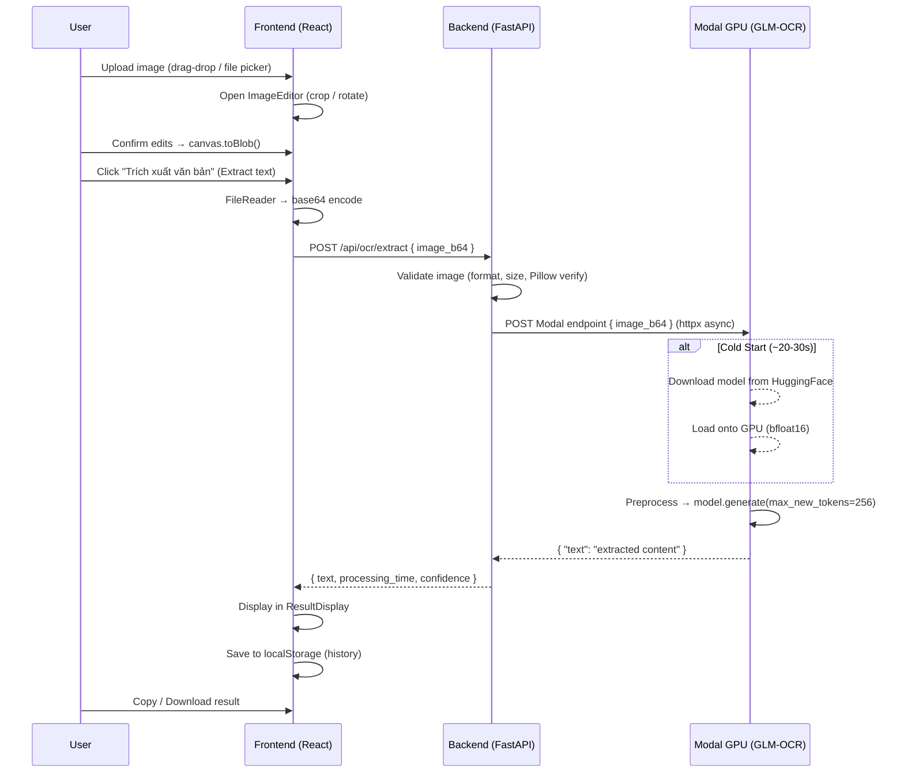

# IntroML-OCR

A full-stack OCR (Optical Character Recognition) web application specialized in **Vietnamese text extraction** from images. The system leverages a fine-tuned **GLM-OCR** model deployed on [Modal](https://modal.com) serverless GPU infrastructure, paired with a modern React frontend and a FastAPI backend proxy.

> **Course Project** — Introduction to Machine Learning

---

## Features

### Core Functionality
- **Vietnamese OCR**: Extract Vietnamese text from images with high accuracy using a fine-tuned GLM-OCR model (`KuongB/glm-ocr-vietnamese`)
- **Multi-language Support**: Supports Vietnamese, English, and mixed Vietnamese–English text recognition
- **Image Upload**: Drag-and-drop or click-to-upload interface accepting PNG, JPG, JPEG, GIF, BMP, and WebP formats (up to 10 MB)
- **Image Editing**: Built-in image editor with crop and 90° rotation before OCR processing

### User Experience
- **Dark / Light Theme**: Toggle between light (mint/teal) and dark (deep slate) themes with smooth CSS transitions
- **Extraction History**: All OCR results are persisted in `localStorage` with timestamps, character counts, and processing times
- **Copy & Download**: One-click copy-to-clipboard and export results as `.txt` files
- **Responsive Layout**: Two-column grid on desktop; single-column stack on mobile (breakpoint at 968 px)

### Backend
- **Proxy Architecture**: Lightweight FastAPI backend — no local ML dependencies, acts as a proxy to the Modal API
- **Retry with Exponential Backoff**: Automatic retry (configurable up to 3 attempts) with 1 s → 2 s → 4 s back-off to handle cold starts
- **Image Validation**: Server-side validation of image format, integrity (via Pillow), and file size before forwarding to the model
- **Interactive API Docs**: Auto-generated Swagger UI (`/api/docs`) and ReDoc (`/api/redoc`)

---

## Demo Screenshots

| Light Theme | Dark Theme |
|:-----------:|:----------:|
|  | |

---

## System Architecture

```
┌──────────────────────────────────────────────────────────────────┐
│                         USER (Browser)                          │
│                                                                  │
│  ┌────────────────────────────────────────────────────────────┐  │
│  │              React + Vite Frontend (:3000)                 │  │
│  │                                                            │  │
│  │  ImageUploader → ImageEditor → App State → ResultDisplay   │  │
│  │                                   ↓                        │  │
│  │                           HistorySidebar                   │  │
│  │                          (localStorage)                    │  │
│  └────────────────────┬───────────────────────────────────────┘  │
│                       │ HTTP (axios)                              │
└───────────────────────┼──────────────────────────────────────────┘
                        │
                        ▼
┌───────────────────────────────────────────────────────────────────┐
│                  FastAPI Backend (:8000)                          │
│                                                                   │
│  ┌──────────┐   ┌───────────┐   ┌──────────────────────────────┐ │
│  │  Routes   │──▶│  Schemas  │   │      OCR Service             │ │
│  │ /api/ocr  │   │ (Pydantic)│   │  • validate_image()          │ │
│  │ /api/health│  └───────────┘   │  • process_with_modal()      │ │
│  └──────────┘                    │  • extract_text()             │ │
│                                  └──────────┬───────────────────┘ │
│                                             │ httpx (async)       │
└─────────────────────────────────────────────┼─────────────────────┘
                                              │
                                              ▼
┌───────────────────────────────────────────────────────────────────┐
│                Modal Serverless GPU (H100)                        │
│                                                                   │
│  ┌──────────────────────────────────────────────────────────────┐ │
│  │  serve.py — GLMOCRModel                                      │ │
│  │                                                               │ │
│  │  @modal.enter()  → load model from HuggingFace               │ │
│  │  predict()       → image → processor → model.generate()      │ │
│  │  ocr_endpoint()  → FastAPI POST endpoint                     │ │
│  └──────────────────────────────────────────────────────────────┘ │
│                                                                   │
│  Model: KuongB/glm-ocr-vietnamese (HuggingFace)                  │
│  GPU: NVIDIA H100 · torch.bfloat16 · device_map="auto"          │
└───────────────────────────────────────────────────────────────────┘
```

---

## Tech Stack

### Frontend
| Technology | Version | Purpose |
|---|---|---|
| React | 18.2 | UI component library |
| Vite | 5.0 | Dev server & build tool |
| Axios | 1.6 | HTTP client |
| react-dropzone | 14.2 | Drag-and-drop file upload |
| react-image-crop | 11.0 | Image cropping |
| Lucide React | 0.309 | Icon library |
| Vanilla CSS | — | Styling with CSS variables & themes |

### Backend
| Technology | Version | Purpose |
|---|---|---|
| FastAPI | 0.109 | Async web framework |
| Uvicorn | 0.27 | ASGI server |
| Pydantic | 2.5 | Data validation & schemas |
| httpx | 0.26 | Async HTTP client (Modal calls) |
| Pillow | 10.2 | Image validation |
| pydantic-settings | 2.1 | Environment config management |

### ML / Inference
| Technology | Purpose |
|---|---|
| Modal | Serverless GPU infrastructure |
| PyTorch | Model inference runtime |
| Transformers (HF) | Model loading & tokenization |
| GLM-OCR | Vision-language model for OCR |
| PEFT | Parameter-efficient fine-tuning |

### DevOps
| Technology | Purpose |
|---|---|
| Docker & Docker Compose | Containerized deployment |
| Nginx | Static file serving & reverse proxy |
| ESLint | Frontend code linting |
| Black & Flake8 | Python code formatting & linting |
| Pytest | Backend unit testing |

---

## Data Flow



### Retry Flow (Backend)

```
Request → Attempt 1 ─── Success ───▶ Return result
                    └── Fail ──▶ Wait 1s ──▶ Attempt 2 ─── Success ──▶ Return result
                                                        └── Fail ──▶ Wait 2s ──▶ Attempt 3
                                                                                    ├── Success ──▶ Return result
                                                                                    └── Fail ──▶ Raise Exception
```

> **Note**: 4xx client errors are **not** retried. Only 5xx server errors, timeouts, and network errors trigger the retry mechanism.

---

## API Documentation

Base URL: `http://localhost:8000/api`

### Health Check

| Method | Endpoint | Description |
|---|---|---|
| `GET` | `/api/health` | Service health check |
| `GET` | `/api/` | Root — returns app info |

**Response** (`GET /api/health`):
```json
{
  "status": "healthy",
  "version": "1.0.0"
}
```

### OCR Endpoints

#### Extract Text from Base64

```
POST /api/ocr/extract
```

**Request Body**:
```json
{
  "image_b64": "<base64-encoded-image-string>"
}
```

**Success Response** (`200`):
```json
{
  "text": "Extracted Vietnamese text content...",
  "processing_time": 3.42,
  "confidence": null
}
```

**Error Responses**:
| Status | Description |
|---|---|
| `400` | Invalid image data (corrupt, oversized, wrong format) |
| `500` | OCR processing failed (Modal API unreachable, all retries exhausted) |

#### Upload Image File

```
POST /api/ocr/upload
Content-Type: multipart/form-data
```

**Form Data**:
| Field | Type | Description |
|---|---|---|
| `file` | `File` | Image file (jpg, png, jpeg) |

**Success Response**: Same as `/extract` endpoint.

#### Supported Languages

```
GET /api/ocr/supported-languages
```

**Response**:
```json
{
  "languages": [
    { "code": "vi", "name": "Vietnamese" },
    { "code": "en", "name": "English" },
    { "code": "mix", "name": "Mixed (Vietnamese + English)" }
  ]
}
```

### Interactive Docs

| URL | Description |
|---|---|
| `http://localhost:8000/api/docs` | Swagger UI |
| `http://localhost:8000/api/redoc` | ReDoc |

---

## Installation

### Prerequisites

- **Python** 3.11+
- **Node.js** 18+ (LTS recommended)
- **Modal** account ([modal.com](https://modal.com))
- **HuggingFace** token ([huggingface.co/settings/tokens](https://huggingface.co/settings/tokens))

### Step 1 — Deploy the Model on Modal

```bash
# Install Modal CLI
pip install modal

# Authenticate
modal setup

# Create HuggingFace secret
modal secret create huggingface-token HF_TOKEN=<your-hf-token>

# Deploy from project root
modal deploy serve.py
```

After successful deployment, you will receive an endpoint URL:
```
https://<your-username>--glm-ocr-api-ocr-endpoint.modal.run
```

### Step 2 — Backend Setup

```bash
cd backend

# Create virtual environment
python -m venv venv

# Activate (Windows)
venv\Scripts\activate

# Activate (Linux/macOS)
source venv/bin/activate

# Install dependencies
pip install -r requirements.txt

# Configure environment
copy .env.example .env   # Windows
cp .env.example .env     # Linux/macOS
```

Edit `backend/.env`:
```env
MODAL_API_URL=https://<your-username>--glm-ocr-api-ocr-endpoint.modal.run
MODAL_TIMEOUT=60
MODAL_MAX_RETRIES=3
```

Start the backend:
```bash
python main.py
```

The API is now running at `http://localhost:8000` (docs at `/api/docs`).

### Step 3 — Frontend Setup

Open a **new terminal** (keep the backend running):

```bash
cd frontend

# Install dependencies
npm install

# Configure environment
copy .env.example .env   # Windows
cp .env.example .env     # Linux/macOS
```

The default `.env` already points to the local backend:
```env
VITE_API_URL=http://localhost:8000/api
```

Start the frontend:
```bash
npm run dev
```

Open `http://localhost:3000` in your browser.

---

## Docker Deployment

### Quick Start

The backend container requires `MODAL_API_URL`. Provide it through a root `.env`
file before starting the stack:

```bash
# From project root
cp .env.example .env     # Linux/macOS
copy .env.example .env   # Windows
# then edit .env and set MODAL_API_URL

docker compose up --build
```

| Service | URL | Container Port |
|---|---|---|
| Frontend | `http://localhost:3000` | 80 (Nginx) |
| Backend | `http://localhost:8000` | 8000 (Uvicorn) |

### Architecture

```yaml
services:
  backend:
    build: ./backend (Python 3.11-slim)
    port: 8000:8000
    healthcheck: curl /api/health (30s interval)
    restart: unless-stopped

  frontend:
    build: ./frontend (Node 18-alpine → Nginx alpine)
    port: 3000:80
    depends_on: backend
    restart: unless-stopped

networks:
  ocr-network: bridge
```

### Docker Images

**Backend** (`backend/Dockerfile`):
- Base: `python:3.11-slim`
- Installs system build tools + Python dependencies
- Runs: `uvicorn main:app --host 0.0.0.0 --port 8000`

**Frontend** (`frontend/Dockerfile`):
- Build stage: `node:18-alpine` → `npm ci` → `npm run build`
- Production stage: `nginx:alpine` serving static files from `/dist`
- Custom `nginx.conf` with gzip, security headers, SPA routing, and static asset caching (1 year)

### Environment Variables

**Backend** (via `docker-compose.yml`):
| Variable | Default | Description |
|---|---|---|
| `APP_NAME` | `OCR Service API` | Application name |
| `VERSION` | `1.0.0` | API version |
| `DEBUG` | `True` | Debug mode |
| `CORS_ORIGINS` | `http://localhost:3000,http://frontend` | Allowed origins |
| `HF_REPO_ID` | `KuongB/glm-ocr-vietnamese` | Model reference |
| `MAX_IMAGE_SIZE` | `10485760` (10 MB) | Upload size limit |
| `MODAL_API_URL` | *(required)* | Modal endpoint URL — read from the root `.env` |
| `MODAL_TOKEN` | *(optional)* | Modal auth token — read from the root `.env` |
| `MODAL_TIMEOUT` | `60` | Request timeout (seconds) |
| `MODAL_MAX_RETRIES` | `3` | Retry attempts |

**Frontend**:
| Variable | Default | Description |
|---|---|---|
| `VITE_API_URL` | `http://localhost:8000/api` | Backend API base URL |

---

## Project Structure

```
IntroML-OCR/
├── backend/
│   ├── app/
│   │   ├── __init__.py          # FastAPI app factory
│   │   ├── config.py            # Settings (pydantic-settings)
│   │   ├── models/
│   │   │   └── schemas.py       # Pydantic request/response schemas
│   │   ├── routes/
│   │   │   ├── health.py        # Health check endpoints
│   │   │   └── ocr.py           # OCR extraction endpoints
│   │   └── services/
│   │       └── ocr_service.py   # Business logic & Modal API calls
│   ├── main.py                  # Uvicorn entry point
│   ├── requirements.txt         # Python dependencies
│   ├── Dockerfile               # Backend container
│   ├── .env.example             # Environment template
│   └── .gitignore
│
├── frontend/
│   ├── src/
│   │   ├── App.jsx              # Main application component
│   │   ├── App.css              # App-level styles
│   │   ├── index.css            # Global styles & theme variables
│   │   ├── main.jsx             # React entry point
│   │   ├── components/
│   │   │   ├── Header.jsx       # App header with tagline
│   │   │   ├── ImageUploader.jsx# Drag-and-drop upload zone
│   │   │   ├── ImageEditor.jsx  # Crop & rotate editor modal
│   │   │   ├── ResultDisplay.jsx# OCR result with copy/download
│   │   │   ├── HistorySidebar.jsx# Extraction history panel
│   │   │   ├── LoadingSpinner.jsx# Loading indicator
│   │   │   └── ErrorMessage.jsx # Error display
│   │   ├── services/
│   │   │   └── api.js           # Axios API client
│   │   └── assets/
│   │       └── logo_ocr.png     # Application logo
│   ├── index.html               # HTML entry point
│   ├── vite.config.js           # Vite configuration
│   ├── package.json             # Node.js dependencies
│   ├── Dockerfile               # Frontend container (multi-stage)
│   ├── nginx.conf               # Nginx production config
│   └── .env.example             # Frontend env template
│
├── notebook/
│   ├── EDA.ipynb                # Exploratory Data Analysis
│   └── Preprocessing.ipynb      # Data preprocessing pipeline
│
├── annotation_pipeline/         # Dataset annotation pipeline (OCR → SLM → review)
│   ├── run_pipeline.py          # CLI: scan / ocr / correct / review / export
│   ├── serve_corrector.py       # Modal deployment for the correction SLM
│   ├── pipeline/                # Stages, record store, HTTP clients, review server
│   └── tests/
│
├── data_sample/                 # Sample images with ground-truth labels
│   └── 1/
│       ├── 1.jpg ... 10.jpg     # Sample OCR test images
│       └── label.json           # Ground-truth text labels
│
├── serve.py                     # Modal deployment script (GPU inference)
├── test-api-glm.py              # Modal endpoint smoke test
├── docker-compose.yml           # Multi-service orchestration
├── .env.example                 # Root env template (MODAL_API_URL for Docker)
├── .gitignore
└── README.md                    # This file
```

---

## Dataset & Notebooks

The model was fine-tuned on a mix of the team's own handwriting samples and the
**UIT-HWDB** Vietnamese handwriting dataset (word, line, and paragraph splits).

| Notebook | Purpose |
|---|---|
| [`notebook/EDA.ipynb`](notebook/EDA.ipynb) | Exploratory analysis — label statistics, Vietnamese character and diacritic distributions, image properties, data-quality checks |
| [`notebook/Preprocessing.ipynb`](notebook/Preprocessing.ipynb) | Cleans the UIT archives (drops folders with mismatched image/label pairs), explores the merged corpus, and assembles the final `Data/` folder (≈1000 train images in 50-image subfolders + 15 test samples) |

Both notebooks are written for **Google Colab** and expect the team's dataset to
be mounted from Google Drive. Paths such as
`/content/drive/MyDrive/IntroToML - OCR/...` need to be adjusted to your own
Drive layout.

`data_sample/1/` holds 10 sample images with ground-truth text in `label.json`,
in the same format the notebooks produce — useful for a quick end-to-end check
without mounting Drive.

### Annotation Pipeline

[`annotation_pipeline/`](annotation_pipeline/) is the tooling used to *build*
that training data, rather than to analyse it. It turns a folder of raw
handwriting images into reviewed image–text pairs in three stages:

1. **Semi-automatic OCR** — each image is transcribed by the GLM-OCR endpoint
   into a draft, so annotation becomes correction rather than transcription.
2. **SLM correction** — the drafts are sent to a hosted
   [`nrl-ai/vn-spell-correction-small`](https://huggingface.co/nrl-ai/vn-spell-correction-small)
   endpoint (BARTpho-based), which restores diacritics and fixes spelling.
3. **Manual review** — a local web UI shows the image beside the draft and the
   corrected text; nothing reaches the exported dataset until a human approves it.

State lives in a JSONL manifest keyed by image, so every stage is resumable and
failures are retried on the next run instead of aborting the batch. The package
talks only HTTP to both models and has no ML dependencies.

```bash
cd annotation_pipeline
python run_pipeline.py auto      # scan + OCR + correction
python run_pipeline.py review    # human review at http://127.0.0.1:8100
python run_pipeline.py export    # dataset.jsonl + label.json
```

See [annotation_pipeline/README.md](annotation_pipeline/README.md) for setup,
the endpoint contract, and configuration.

---

## Modal Operations

### Cold Starts

The first request after a deploy, or after the container has been idle, takes
roughly **20–30 s** while the model is downloaded from HuggingFace and loaded
onto the GPU. Subsequent requests take about **2–5 s**. The backend's retry
logic (1 s → 2 s → 4 s back-off) is there to absorb this transparently.

The container shuts down automatically after a few minutes of inactivity, so the
next request pays the cold start again.

### Development vs Production

```bash
# Development — ephemeral endpoint, live-reloads on file changes
modal serve serve.py

# Production — persistent endpoint
modal deploy serve.py
```

`modal serve` prints a temporary `...-dev.modal.run` URL; `modal deploy` prints
the stable one. Re-running `modal deploy` after editing `serve.py` updates the
deployment with no downtime.

### Smoke Test

```bash
python test-api-glm.py data_sample/1/1.jpg
```

The endpoint URL defaults to the development endpoint and can be overridden with
a second argument or the `MODAL_API_URL` environment variable.

### Monitoring

Logs, metrics, and GPU usage are available at
[modal.com/apps](https://modal.com/apps).

### Troubleshooting

| Error | Fix |
|---|---|
| `Secret not found` | Run `modal secret list`, then `modal secret create huggingface-token HF_TOKEN=<your-token>` |
| `Model not found` | Check `HF_REPO_ID` in `serve.py` and that your HuggingFace token can read that repo |
| `GPU quota exceeded` | Wait for the quota to reset or upgrade the Modal plan |
| Backend returns `500` on every request | `MODAL_API_URL` is unset or wrong — check `backend/.env` |

---

## License

This project is developed for educational purposes as part of an Introduction to Machine Learning course.

---

<p align="center">
  <b>IntroML-OCR</b> — Vietnamese OCR powered by GLM-OCR & Modal
</p>
